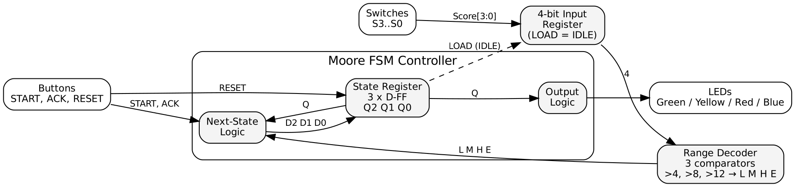

# Digital System Design – Group Project

## 1. Team Details
| Role | Student name | Roll number | GitHub username |
|---|---|---|---|
| Group leader | Kulkarni Keshavraj Yogesh | D9A-29 | [Username] |
| Member 2 | Manthan Sunil Januskar | D9A-23 | [Username] |
| Member 3 | Nandini Ananthasubramaniam | D9B-40 | [Username] |
| Member 4 | Palaksh Pratap Singh | D9B-59 | [Username] |

**Class:** D9 (D9A + D9B)  
**Group ID:** D9_Group04  
**Repository URL:** [Fork URL]  
**Final Pull Request URL:** [URL]

## 2. Assigned Problem Statement
- **Number/title:** Game Score Categorizer – Suggested modification H1: Four-Category Score Categorizer (Add Excellent)
- **Problem summary:** A 4-bit score from switches is sampled when START is pressed and classified into Low, Medium, High or Excellent. A Moore FSM keeps the result on an indicator LED until ACK is pressed.
- **Objective:** Correctly classify all 16 scores (0–15), hold the result until acknowledged, and return to IDLE on ACK or RESET.
- **Inputs and outputs:** `Score[3:0]` (switches), `START`, `ACK`, `RESET` (synchronous, active-high), `Clock`; outputs `LED_LOW` (green), `LED_MEDIUM` (yellow), `LED_HIGH` (red), `LED_EXCELLENT` (blue).
- **Constraints and assumptions:** Low 0–4, Medium 5–8, High 9–12, Excellent 13–15. Score is unsigned so all inputs are valid. START and switches are ignored outside IDLE. Unused state codes return to IDLE. Details in `01_Problem_Analysis/README.md`.

## 3. Problem Analysis and Proposed Solution
The system is split into a datapath (4-bit input register and a comparator-based range decoder) and a Moore FSM controller (3-bit state register, next-state logic, output logic). The input register loads the switches on every clock while the FSM is in IDLE and holds the value in all other states, so the FSM always decides from a stable registered score and the result cannot change after START. Edge cases covered: range boundaries, START held down, START and ACK together, ACK in IDLE, switch changes during a result, RESET in any state.

**Distinctive feature:** the RGB LED on the board lights in the category colour (green, yellow, red, blue) in addition to the four category LEDs.

The design is feasible: 7 flip-flops plus a few gates in Logisim, and a small fraction of the Spartan-7 resources on the FPGA.

## 4. Architecture

| Block | Function |
|---|---|
| Input register | 4 D flip-flops, LOAD = IDLE |
| Range decoder | 3 comparators (> 4, > 8, > 12) + gates give L, M, H, E from the registered score |
| Next-state logic | D2, D1, D0 from state, START, ACK, RESET and L/M/H/E |
| State register | 3 D flip-flops (Q2 Q1 Q0) |
| Output logic | One LED per category state (Moore) |
| Clock divider (FPGA only) | 100 MHz to ~95 Hz for the FSM |

## 5. FSM Design
Moore FSM, 5 states, 3-bit binary encoding: IDLE 000, LOW 001, MEDIUM 010, HIGH 011, EXCELLENT 100. IDLE goes to the category of the registered score when START = 1; every category state returns to IDLE when ACK = 1. Synchronous active-high RESET forces IDLE. Codes 101–111 go to IDLE.

**Diagram:** `02_FSM_Logisim/state_diagram.png`  
**State table:** `02_FSM_Logisim/FSM_Design.md`

## 6. Logisim Implementation
- Logisim version: Logisim Evolution 5.0.0
- Circuit file: `02_FSM_Logisim/Game_Score_Categorizer.circ`
- Test cases and expected/observed behaviour: all 16 scores with START, hold, ACK and RESET; see `02_FSM_Logisim/README.md` and `logisim_netlist_check.txt` (16/16 pass)
- Issues and corrections: [ ]
- Screenshot/evidence: `02_FSM_Logisim/` [add screenshots]

## 7. Verilog HDL Implementation
- Tool/version: Vivado 2018.3 (also checked with Icarus Verilog 12)
- Top module and submodules: `Game_Score_Top` (board) → `Game_Score_Categorizer` (FSM + datapath)
- Architecture/coding decisions: `parameter` state codes, `case` on the state with `begin/end` per state and `if/else` transitions, Moore outputs assigned in every state, synchronous reset
- Synthesizability considerations: all outputs assigned in every branch (no latches), `default` branches for unused codes, single clock domain
- RTL: `03_Verilog_Implementation/RTL/`
- Testbench: `03_Verilog_Implementation/Testbench/`

## 8. Verification and Simulation Results
| Test ID | Inputs/conditions | Expected output | Observed output | Pass/Fail |
|---|---|---|---|---|
| T01 | RESET | IDLE, LEDs off | Pending | Pending |
| T02 | START = 0 in IDLE | IDLE | Pending | Pending |
| T03 | ACK in IDLE | IDLE | Pending | Pending |
| T04 | All 16 scores + START, switch change, ACK | Correct category, held, then IDLE | Pending | Pending |
| T05 | START held | One transition | Pending | Pending |
| T06 | START + ACK together | START in IDLE, ACK in category | Pending | Pending |
| T07 | RESET from every category | IDLE | Pending | Pending |
| T08 | Boundaries 4, 5, 8, 9, 12, 13 | Correct category | Pending | Pending |

Tool/version: Vivado 2018.3 [add Vivado screenshot]  
Number passed/failed: Pending (to be run in Vivado 2018.3)  
Waveform/log path: `03_Verilog_Implementation/Simulation_Results/`

## 9. FPGA Hardware Implementation
- FPGA board/device: RealDigital Boolean board, Xilinx Spartan-7 xc7s50csga324-1
- Tool/version: Vivado 2018.3
- Clock/constraints: 100 MHz on F14, divided to ~95 Hz; pin map in `04_FPGA_Hardware/Boolean_Game_Score.xdc`
- Synthesis/implementation summary: [LUTs / FFs / CARRY4 from `04_FPGA_Hardware/reports/utilization.txt`]
- Programming and hardware test result: [ ]
- Evidence path: `04_FPGA_Hardware/`

Explain differences between simulation and hardware results, if any: [ ]

## 10. Challenges, Debugging and Improvements
| Issue | Root cause | Correction | Outcome |
|---|---|---|---|
| Score read in the same clock as it is loaded would use the old value | Register update and FSM decision happen on the same edge | Register loads continuously in IDLE and freezes when the FSM leaves IDLE | FSM always uses a stable sampled score |
| Five states do not fit in 2 bits | H1 adds EXCELLENT | 3-bit state register, unused codes go to IDLE | Safe recovery from illegal states |
| Buttons on the board bounce | Mechanical contacts | FSM clocked at ~95 Hz | Single clean transition per press |

Future improvements: show the score on the 7-segment display, add category counters (H4), add a CHANGE signal (H5).

## 11. Task Allocation and Individual Contribution
| Student | Assigned responsibility | Actual contribution/evidence |
|---|---|---|
| Group leader (Keshavraj Kulkarni) | [ ] | [ ] |
| Member 2 (Manthan Januskar) | [ ] | [ ] |
| Member 3 (Nandini Ananthasubramaniam) | [ ] | [ ] |
| Member 4 (Palaksh Pratap Singh) | [ ] | [ ] |

Every student must be ready to explain the complete design.

## 12. Progress Log
Maintain time-wise updates in `STATUS.md`.

## 13. Final Results and Conclusion
In Logisim, all 16 scores are classified correctly into four categories, the result is held until ACK, and RESET returns to IDLE from any state. Verilog simulation results: [pending, to be run in Vivado 2018.3]. Hardware results: [to be added after the board demonstration]. Limitation: one score per transaction, ACK required before the next.

## 14. Team Reflection
[Write here]

## 15. Final Submission Checklist
- [x] Team details and problem analysis complete.
- [x] Architecture/block diagram included.
- [x] FSM diagram/table or justified alternative included.
- [x] Logisim source and simulation evidence uploaded.
- [ ] Verilog RTL and testbench uploaded.
- [ ] Simulation results and test cases documented.
- [ ] FPGA implementation and hardware evidence uploaded.
- [ ] Results, challenges and conclusion documented.
- [ ] Presentation and final report uploaded.
- [ ] STATUS.md is up to date.
- [ ] Final Pull Request created and URL recorded.
